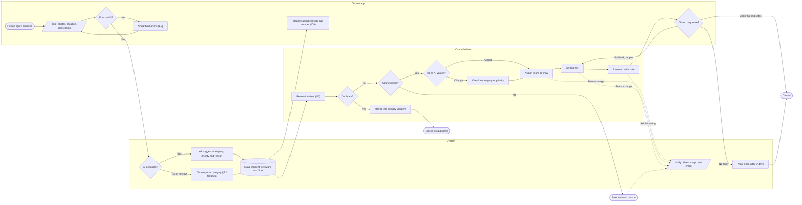
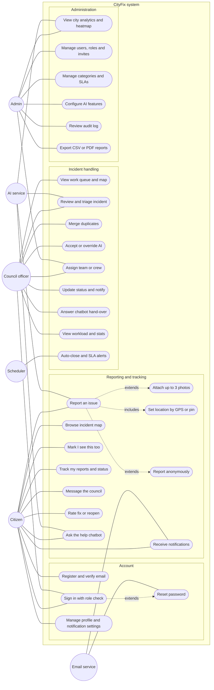
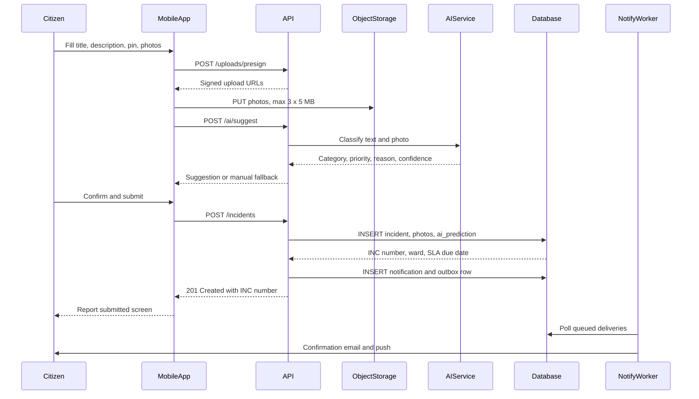
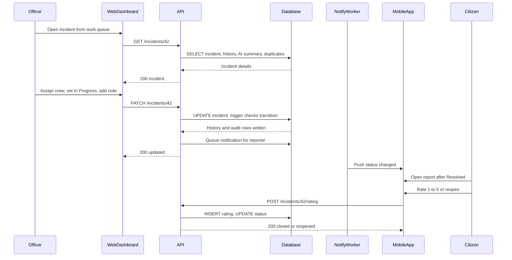

# CityFix – design diagrams (Mermaid source)

Editable versions are on the FigJam board: https://www.figma.com/board/1g3DsXNjakjDH4c3USGKjs
These sources render on GitHub, in VS Code (Mermaid preview) and at mermaid.live.

## 1. Incident lifecycle flowchart



## 2. Use-case diagram

Mermaid has no UML use-case type, so this uses a flowchart: circles are actors, rounded boxes are use cases, dotted arrows are «include»/«extend».



## 3a. ERD – incidents and workflow

```mermaid
erDiagram
    USERS ||--o{
        INCIDENTS : reports
    USERS |o..o{
        INCIDENTS : handles
    CATEGORIES ||--o{
        INCIDENTS : classifies
    CATEGORIES |o..o{
        CATEGORIES : parent_of
    CATEGORIES ||--o{
        SLA_PRIORITY_OVERRIDES : has
    DEPARTMENTS ||--o{
        CATEGORIES : routes
    DEPARTMENTS ||--o{
        TEAMS : has
    DEPARTMENTS |o..o{
        USERS : employs
    TEAMS |o..o{
        INCIDENTS : works_on
    WARDS |o..o{
        INCIDENTS : contains
    INCIDENTS |o..o{
        INCIDENTS : merged_into
    INCIDENTS ||--o{
        INCIDENT_STATUS_HISTORY : logs
    INCIDENTS ||--o{
        INCIDENT_ASSIGNMENTS : tracks
    INCIDENTS ||--o{
        INCIDENT_SUPPORTERS : supported_by
    USERS ||--o{
        INCIDENT_SUPPORTERS : supports
    INCIDENTS ||--o{
        INCIDENT_MESSAGES : has
    INCIDENTS ||--o{
        INCIDENT_ATTACHMENTS : has
    INCIDENT_MESSAGES |o..o{
        INCIDENT_ATTACHMENTS : attaches
    INCIDENTS ||--o{
        INCIDENT_RATINGS : rated_by
    USERS {
        uuid id PK
        string email UK
        string full_name
        enum role
        enum status
        smallint department_id FK
        smallint team_id FK
    }
    DEPARTMENTS {
        smallint id PK
        string name UK
        string code UK
    }
    TEAMS {
        smallint id PK
        smallint department_id FK
        string name
        bool is_field_crew
    }
    WARDS {
        smallint id PK
        string name UK
        geometry boundary
    }
    CATEGORIES {
        smallint id PK
        smallint parent_id FK
        string name
        smallint default_department_id FK
        smallint default_team_id FK
        smallint sla_days
    }
    SLA_PRIORITY_OVERRIDES {
        smallint category_id PK, FK
        enum priority PK
        int sla_hours
    }
    INCIDENTS {
        bigint id PK
        string reference_no UK
        uuid reporter_id FK
        bool is_anonymous
        geography location
        smallint ward_id FK
        smallint category_id FK
        enum priority
        smallint ai_category_id FK
        enum ai_priority
        enum status
        smallint assigned_team_id FK
        uuid assigned_officer_id FK
        datetime sla_due_at
        bigint merged_into_id FK
        smallint reopen_count
    }
    INCIDENT_STATUS_HISTORY {
        bigint id PK
        bigint incident_id FK
        enum from_status
        enum to_status
        uuid changed_by FK
        text note
    }
    INCIDENT_ASSIGNMENTS {
        bigint id PK
        bigint incident_id FK
        smallint team_id FK
        uuid officer_id FK
        datetime ended_at
    }
    INCIDENT_SUPPORTERS {
        bigint incident_id PK, FK
        uuid user_id PK, FK
    }
    INCIDENT_MESSAGES {
        bigint id PK
        bigint incident_id FK
        uuid sender_id FK
        text body
        bool is_internal
    }
    INCIDENT_ATTACHMENTS {
        uuid id PK
        bigint incident_id FK
        bigint message_id FK
        enum kind
        string storage_key UK
        int size_bytes
    }
    INCIDENT_RATINGS {
        bigint id PK
        bigint incident_id FK
        uuid citizen_id FK
        smallint score
        bool requested_reopen
    }
```

`incident_status_transitions` is a rule table with no foreign keys, so it is not drawn.

## 3b. ERD – accounts and notifications

```mermaid
erDiagram
    USERS ||--o{
        AUTH_TOKENS : has
    USERS ||--o{
        USER_SESSIONS : signs_in
    USERS ||--o{
        DEVICE_PUSH_TOKENS : registers
    USERS ||--o{
        NOTIFICATION_PREFERENCES : sets
    USERS ||--o{
        NOTIFICATIONS : receives
    USERS ||--o{
        STAFF_INVITATIONS : sends
    DEPARTMENTS |o..o{
        STAFF_INVITATIONS : for
    INCIDENTS |o..o{
        NOTIFICATIONS : about
    NOTIFICATIONS ||--o{
        NOTIFICATION_DELIVERIES : sent_via
```

## 3c. ERD – AI, chatbot and administration

```mermaid
erDiagram
    INCIDENTS |o..o{
        AI_PREDICTIONS : analysed_by
    CATEGORIES |o..o{
        AI_PREDICTIONS : suggested_in
    USERS |o..o{
        AI_PREDICTIONS : decides
    AI_SETTINGS ||..o{
        AI_PREDICTIONS : governs
    AI_PREDICTIONS |o..o{
        ANALYTICS_SUMMARIES : writes
    WARDS |o..o{
        ANALYTICS_SUMMARIES : covers
    USERS ||--o{
        CHAT_CONVERSATIONS : starts
    INCIDENTS |o..o{
        CHAT_CONVERSATIONS : about
    CHAT_CONVERSATIONS ||--o{
        CHAT_MESSAGES : contains
    AI_PREDICTIONS |o..o{
        CHAT_MESSAGES : answers
    USERS ||--o{
        EXPORT_JOBS : requests
    USERS |o..o{
        APP_FEEDBACK : sends
    USERS |o..o{
        AUDIT_LOGS : performs
    CATEGORIES |o..o{
        FAQ_ARTICLES : groups
```

Full columns for 3b and 3c are in `db/schema.sql` and on the FigJam board.

## 4a. Sequence – citizen submits a report



## 4b. Sequence – officer updates, citizen rates or reopens


